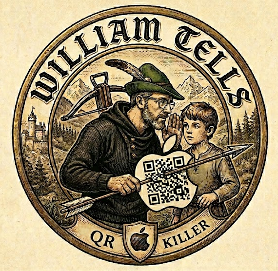

# William Tells QR Killer

<p align="center">
  
  <br><br>
  <a href="https://suno.com/s/8ySO7rhVdKfcSQ6I">Theme Song</a>
</p>

QR code decoder using Apple's Vision framework. Runs on any Mac (local or AWS mac2 instances) and decodes QR codes exactly the way an iPhone does — including obfuscated codes that open-source decoders (ZXing, pyzbar, ZBar) miss.

Includes a web UI for drag-and-drop scanning and an async job queue API for programmatic use.

## Why Apple Vision?

Open-source QR decoders behave differently than Apple's. A QR code that an iPhone reads may decode differently (or not at all) in ZXing/pyzbar. This service gives you identical decode behavior to iOS in a scriptable API.

For hard-to-read QR codes (low contrast, darkened, blurred), the service applies image mutations — brightness, contrast, scale, blur, rotation, sharpen — simulating what an iPhone camera does physically when pointing at a screen.

## Requirements

- macOS 13+ (Ventura or later)
- Swift 5.9+
- Xcode Command Line Tools
- Apple Silicon recommended (M1/M2 — uses Metal GPU + Neural Engine)

## Quick Start

> The Vapor server scans each upload in its own **App-Sandboxed `wtqrk-scan` process** (no
> network, no file access, a fresh process per image; see [Native sandbox](#native-sandbox)).
> `WTQRK_SCAN_BACKEND=inprocess` restores the old in-process decoding, for trusted images only.
> To plug into Loadout or a blastbox fleet, deploy the [blastbox engine](#sandboxed-scanning-with-blastbox).

```bash
# Build
swift build -c release

# Run
.build/release/App
# Listening on http://0.0.0.0:8080

# Open the web UI
open http://localhost:8080
```

## Authentication

Optional basic auth via environment variables:

```bash
WTQRK_USER=admin WTQRK_PASS=secret .build/release/App
```

When set, all endpoints except `/health` require basic auth. When unset, no auth is required.

## Web UI

Visit `http://localhost:8080` for a drag-and-drop interface. Supports multiple files, shows decoded payloads with bounding boxes and mutation counts.

Supported formats: PNG, JPEG, HEIC, HEIF, WebP, TIFF, GIF, BMP, SVG, PDF.

## API

All scan endpoints are async — they return a job ID immediately (HTTP 202) and you poll for results.

### Submit a scan

**`POST /scan`** — Single image, default config (~60 mutations, early exit on first detection)

```bash
B64=$(base64 -i qr_image.png)

# Submit
curl -X POST http://localhost:8080/scan \
  -H "Content-Type: application/json" \
  -d "{\"imageBase64\": \"$B64\"}"
```

Response (202 Accepted):
```json
{
  "id": "1C28E693-FDA6-42F4-8F2A-A5E8CB8A8DCC",
  "status": "queued"
}
```

**`POST /scan/heavy`** — Full mutation sweep (~10,000 mutations, no early exit). Use when `/scan` finds nothing.

**`POST /scan/batch`** — Multiple images in one request (max 20):

```json
{
  "images": [
    { "id": "img-001", "imageBase64": "..." },
    { "id": "img-002", "imageBase64": "..." }
  ],
  "config": { }
}
```

**`POST /upload`** — Multipart file upload (used by the web UI).

### Poll for results

**`GET /jobs/:id`**

```bash
curl http://localhost:8080/jobs/1C28E693-FDA6-42F4-8F2A-A5E8CB8A8DCC
```

Status values: `queued`, `processing`, `completed`, `failed`.

Completed response:
```json
{
  "id": "1C28E693-FDA6-42F4-8F2A-A5E8CB8A8DCC",
  "status": "completed",
  "createdAt": "2026-03-25T12:00:00Z",
  "startedAt": "2026-03-25T12:00:00Z",
  "completedAt": "2026-03-25T12:00:01Z",
  "result": {
    "scanReport": {
      "imageDimensions": { "width": 800, "height": 823 },
      "mutationsTried": 0,
      "detections": [
        {
          "payload": "https://example.com",
          "symbology": "VNBarcodeSymbologyQR",
          "confidence": 1.0,
          "boundingBox": { "x": 0.35, "y": 0.35, "width": 0.34, "height": 0.22 }
        }
      ]
    }
  }
}
```

`mutationsTried: 0` means the QR decoded on the raw image (no mutations needed).

### Utility endpoints

- **`GET /health`** — Returns `ok`. No auth required.
- **`GET /config`** — Returns default and heavy mutation configs with total mutation counts.

## Custom Mutation Config

Override the default mutations by passing a `config` object:

```json
{
  "imageBase64": "...",
  "config": {
    "scales": [0.75, 1.0, 1.5],
    "brightnessDeltas": [-0.3, 0.0, 0.3],
    "contrastDeltas": [-0.1, 0.0],
    "blurRadii": [0.0, 1.0],
    "rotationDegrees": [0.0],
    "sharpenIntensities": [0.0]
  }
}
```

Limits: max 10 values per dimension, max 10,000 total mutations. Scale must be in (0, 5.0], blur in [0, 10.0].

## How Mutations Work

The raw image is tried first. If no QR is detected, mutations are applied via CoreImage on the Metal GPU:

| Mutation | Simulates |
|----------|-----------|
| Scale | Phone distance from screen |
| Brightness | Auto-exposure adjusting to ambient light |
| Contrast | Screen brightness vs room lighting |
| Blur | Camera focus hunting |
| Rotation | Phone tilt |
| Sharpen | Camera snapping to focus |

Default config covers brightness extremes and contrast adjustments that catch most obfuscated QR codes in ~60 mutations. Heavy mode does a full sweep across all axes (~6,000 mutations).

## Architecture

```
HTTP requests ──> Vapor (async) ──> Job Queue (FIFO)
                                        │
                         Scan backend (WTQRK_SANDBOX_SLOTS, default 4)
                                   ┌────┬────┬────┬───┐
                                   │ S1 │ S2 │ .. │ Sn│
                                   └────┴────┴────┴───┘
                                        │
                              Metal GPU + Neural Engine
```

- **`WTQRK_SANDBOX_SLOTS` scan slots** (default 4, max 32): App Sandbox slots, or with
  `WTQRK_SCAN_BACKEND=inprocess` that many QRScannerEngine instances, each with its own
  Metal-backed CIContext
- **One worker task per slot** pulls jobs from an AsyncStream FIFO queue, so every slot is used
- **Semaphore-style checkout/checkin** — when all engines are busy, jobs wait in queue
- **Bounded queue** — rejects with 429 when the queue exceeds `WTQRK_MAX_QUEUE` (default 100)
- Input validation (bad base64, config limits, batch size) returns 400 immediately before queueing
- Completed/failed jobs are evicted after 1 hour

## Supported Barcode Types

QR, Micro QR, Data Matrix, PDF417, Aztec, Code 128, Code 39, Code 93, EAN-8, EAN-13, UPC-E, ITF-14, GS1 DataBar, GS1 DataBar Expanded, Codabar.

## AWS Deployment

Tested on `mac2.metal` (M1). Should work on any Apple Silicon EC2 instance type (`mac2-m2.metal`, `mac2-m2pro.metal`, etc.).

> **Cost warning:** EC2 Mac instances require a dedicated host, and AWS enforces a **minimum 24-hour allocation** (Apple licensing requirement). You will be billed for the full 24 hours even if you only use the instance for 10 minutes. Plan accordingly.

A Terraform config is included in `terraform/` that provisions everything — dedicated host, EC2 instance, VPC, ALB with HTTPS, ACM certificate, and Route53 DNS.

### Terraform setup

```bash
cd terraform
cp terraform.tfvars.example terraform.tfvars
```

Edit `terraform.tfvars` with your values:

| Variable | Description |
|----------|-------------|
| `hostname` | FQDN for the service (e.g. `qrscanner.yourdomain.com`) |
| `hosted_zone_id` | Route53 hosted zone ID for your domain |
| `key_name` | EC2 key pair name for SSH access |
| `private_key_path` | Path to the corresponding private key file |
| `ssh_allowed_cidrs` | Your IP(s) for SSH access (e.g. `["1.2.3.4/32"]`) |
| `wtqrk_user` / `wtqrk_pass` | Optional — basic auth credentials |

Then deploy:

```bash
terraform init
terraform plan
terraform apply
```

Terraform handles the build, launchd service install, and health check automatically via SSH provisioning.

## Environment Variables

| Variable | Default | Description |
|----------|---------|-------------|
| `PORT` | `8080` | HTTP listen port |
| `WTQRK_USER` | _(none)_ | Basic auth username (both must be set to enable) |
| `WTQRK_PASS` | _(none)_ | Basic auth password |
| `WTQRK_MAX_QUEUE` | `100` | Max pending jobs before 429 rejection |
| `WTQRK_SCAN_BACKEND` | `sandbox` | `sandbox`: one App-Sandboxed process per image. `inprocess`: decode inside the server (trusted images only) |
| `WTQRK_SANDBOX_SLOTS` | `4` | Concurrent scans (1–32): sandbox slots, or in-process engines; the job queue runs one worker per slot |
| `WTQRK_SCAN_BIN` | next to `App` | The `wtqrk-scan` binary to sandbox |
| `WTQRK_SLOT_ROOT` | `~/Library/Application Support/wtqrk/slots` | Where slots (signed scanner copies) live |

## Native sandbox

Vision, ImageIO and CoreGraphics are high-value exploit targets (FORCEDENTRY went through
CoreGraphics, BLASTPASS through ImageIO's WebP decoder). So nothing long-lived here decodes an
image. Each one goes to a fresh `wtqrk-scan` process that **the kernel App-Sandboxes at exec**,
from the binary's own (ad-hoc, free) signature:

- **No path grants.** The image arrives as an open file descriptor on stdin.
- **No network, no files** outside the process's own container, which is wiped before and after
  every image. Concurrent scans use separate slots, each with its own container.
- **Time and memory caps**; output is validated as untrusted before anyone sees it.
- **Self-test gate.** At startup the scanner must decode a freshly generated QR (on the Neural
  Engine where present), report that it was sandboxed, and fail a confinement probe: it may not
  read a canary file outside its container or connect to a loopback listener. Until that passes,
  every scan is an error, never "no QR found" (a sandbox missing a Vision grant finds nothing
  rather than failing).
- **Warm plan cache.** The self-test's compiled Neural Engine plan is copied (copy-on-write) into
  each scan's fresh container, so a scan costs ~0.1 s instead of ~0.6 s. Nothing flows back.

No `sandbox-exec`, no Python. Why not XPC: launchd throttles an XPC service that exits within 10 s
of launching, so XPC can't give each image a fresh process. The code is `Sources/QRSandbox/`
(used by the web service and `wtqrk-worker`); slots live in
`~/Library/Application Support/wtqrk/slots` (`WTQRK_SLOT_ROOT`), and `WTQRK_SANDBOX_SLOTS`
(default 4) sets the web service's concurrency.

## Sandboxed scanning with blastbox

Run William Tells as the [blastbox](https://github.com/wmetcalf/blastbox) engine `williamtells`
to put it behind blastbox's queue, dispatcher and signed attestation. It is deployed like
ClippyShot, RedTusk and titanarum, so [Loadout](https://github.com/wmetcalf/loadout) drives it the
same way. The Macs run **`wtqrk-worker`**, a native Swift agent that speaks blastbox's worker
protocol and scans through the [native sandbox](#native-sandbox).

```
client / Loadout ──▶ blastbox serve ──▶ queue ──▶ blastbox dispatch ──▶ Mac: wtqrk-worker ──▶ App Sandbox ──▶ wtqrk-scan
                     (+ this UI)                  (static pool)         (Swift, no Python)    (per image)
```

The ingress and dispatcher never decode an image; only the sandboxed `wtqrk-scan` does. They
can run on the Mac (Mac-only) or on Linux next to the other engines, with Macs as the pool.

| Path | What |
|---|---|
| `Sources/wtqrk-scan/` | One-shot CLI: `scan <image>` → one JSON document on stdout; `self-test`; `render-qr`; `devices`. No Vapor. |
| `Sources/QRScanCore/` | The scanner and models, shared by the Vapor service and the CLI. Raster input goes through an ImageIO type allowlist and a 100 M-pixel cap checked before decode. |
| `Sources/QRSandbox/` | The native sandbox: slots, the per-image runner, the self-test/confinement gate, output validation, the blastbox envelope. |
| `Sources/wtqrk-worker/` | Native blastbox worker agent (`GET /healthz`, `POST /detonate`). |
| `deploy/macos/io.github.wmetcalf.wtqrk-worker.plist` | launchd agent for `wtqrk-worker`. |
| `python/william_tells/blastbox_engine.py` | The same engine for blastbox's Python `http_agent` (seatbelt/appsandbox), if you'd rather run that. |
| `python/william_tells/blastbox_ingress.py` + `static/` | Ingress extension: this web UI at `/` and `/jobs/<id>`, on top of the core `/v1/jobs` API. |
| `deploy/blastbox/williamtells-host.env.example` | Ingress + dispatcher config (one file both source). |
| `deploy/blastbox/williamtells-worker.env.example` | Mac worker-agent config. |
| `deploy/docker/` | Linux host stack (ingress + static-pool dispatcher + postgres) for [remote Mac workers](#linux-host--remote-mac-workers). |

### Install a Mac worker

```bash
swift build -c release                              # App, wtqrk-scan, wtqrk-worker
sudo install -d /opt/william-tells/bin
sudo install .build/release/wtqrk-worker .build/release/wtqrk-scan /opt/william-tells/bin/
cp deploy/macos/io.github.wmetcalf.wtqrk-worker.plist ~/Library/LaunchAgents/   # set the token
launchctl bootstrap gui/$(id -u) ~/Library/LaunchAgents/io.github.wmetcalf.wtqrk-worker.plist
grep "self-test passed" /tmp/wtqrk-worker.log       # the gate ran on this Mac
```

It must run in a per-user launchd domain: App Sandbox can't start the scanner from a
LaunchDaemon (the system domain), so the self-test fails there. For a Mac with no GUI login, load
it into `user/<uid>` with `LimitLoadToSessionType` `Background`; the plist's header has the
commands, and `terraform/` deploys the web service that way.

The ingress and dispatcher run wherever your other blastbox engines do. For a Mac-only
deployment, load blastbox's `deploy/macos/io.blastbox.ingress.plist` and
`io.blastbox.dispatcher.plist` (`pip install -e python/` gives you blastbox), both pointed at your
copy of `williamtells-host.env.example`.

### Linux host + remote Mac workers

`deploy/docker/` runs the ingress (with this UI) and a static-pool dispatcher on a Linux blastbox
host, next to the other engines. Nothing on that host decodes an image: every job goes to a Mac
over https with mutual TLS, and only the Mac's sandbox touches the input.

```
Loadout ──▶ Linux: blastbox serve ──▶ postgres queue ──▶ blastbox dispatch ══ https + mTLS ══▶ Mac: http_agent ──▶ seatbelt ──▶ wtqrk-scan
            (docker, :8005)                               (static pool)                       (WilliamTellsEngine)
```

The Macs run blastbox's Python `http_agent` with `WilliamTellsEngine`, not `wtqrk-worker`: the
dispatcher's mTLS needs the agent to serve TLS and check client certs, and `wtqrk-worker` speaks
plain HTTP for a local dispatcher only.

1. **PKI, on the host.** `blastbox pki init` creates the CA and the dispatcher's client cert if
   you don't have them yet. Give the dispatcher container `ca.crt`, `dispatcher.crt` and
   `dispatcher.key`, readable by uid 10001; that directory is `WILLIAMTELLS_PKI_DIR`.
2. **Worker cert, keeping the key on the Mac.** Generate a key and CSR on the Mac, with the
   address the dispatcher will dial as the subject alt name:
   ```bash
   openssl ecparam -name prime256v1 -genkey -noout -out worker.key && chmod 600 worker.key
   openssl req -new -key worker.key -subj "/CN=<mac-name>" -addext "subjectAltName=IP:<mac-ip>" -out worker.csr
   ```
   Copy only `worker.csr` to the host, then sign it with `blastbox pki sign-csr --csr worker.csr --out worker.crt --days 365`.
   Copy `worker.crt` and `ca.crt` back. The dispatcher checks the SAN, so if the Mac's
   address changes, issue a new cert. A DHCP reservation, or a tunnel address as described
   below, avoids that.
3. **Mac agent.** Install blastbox and `william-tells-blastbox` (`python/`) into a venv, then run
   `python -I -m blastbox.worker.http_agent` from a per-user LaunchAgent (blastbox's
   `deploy/macos/io.blastbox.worker-agent.plist`) with:
   | Variable | Value |
   |---|---|
   | `BLASTBOX_ENGINE` | `william_tells.blastbox_engine:WilliamTellsEngine` |
   | `BLASTBOX_SANDBOX` | `seatbelt` (or `appsandbox`) |
   | `WTQRK_SCAN_BIN` | `/opt/william-tells/bin/wtqrk-scan` |
   | `BLASTBOX_WORKER_AGENT_BIND` | the address in the cert's SAN |
   | `BLASTBOX_WORKER_AGENT_PORT` | `8765` |
   | `BLASTBOX_WORKER_AGENT_TLS_CERT` / `_TLS_KEY` | `worker.crt` / `worker.key` |
   | `BLASTBOX_WORKER_AGENT_CLIENT_CA` | `ca.crt`: only the dispatcher's cert gets in |
   | `BLASTBOX_WORKER_AGENT_ALLOW_CIDRS` | the dispatcher host's source address, as `/32` |
   | `BLASTBOX_WORKER_AGENT_TOKEN` | a random secret, also set on the dispatcher |

   Its log should show `self-test passed` and `tls=True mtls=True allowlist=True`.
4. **Host stack.** Everything runs from `deploy/docker/`, because Compose only looks for
   `docker-compose.yml` and `.env` in the current directory and its parents:
   ```bash
   cd deploy/docker
   install -m 600 .env.example .env      # then fill in every REPLACE_ME
   docker compose -p williamtells-bb up -d --build
   ```
   `BLASTBOX_STATIC_WORKERS` is one `https://<mac-ip>:8765` per Mac, and the pool and
   concurrency sizes equal the number of Macs. `.dockerignore` keeps `.env` (the database
   password and worker token) out of the build context. `BLASTBOX_ATTEST_KEY` is created on
   the first job, in `WILLIAMTELLS_KEY_DIR`. Only the dispatcher mounts that directory, so a
   compromised API container can't read or replace the signing key; keep it outside the data
   dir. To get its `key_id` and public key, run
   `docker compose -p williamtells-bb exec dispatcher blastbox attest-key --key /keys/attest.key`.
   The ingress's `GET /v1/attestation/key` answers 404 in this stack, because the ingress
   serves it only when it holds the private key. Hand the `attest-key` output to clients
   instead: they pin that key to verify results, e.g. with `blastbox attest verify`.
5. **Check it.** From `deploy/docker` on the host, check each Mac in `BLASTBOX_STATIC_WORKERS`.
   The certificates come from `WILLIAMTELLS_PKI_DIR`, and `sudo` is needed because
   `dispatcher.key` is readable only by uid 10001. The token goes in on stdin, so it never shows
   up in a process listing:
   ```bash
   # value only: a trailing " # comment" is dropped, as Compose does
   P=$(sed -nE 's/^WILLIAMTELLS_PKI_DIR=([^[:space:]]*).*/\1/p' .env)
   sed -nE 's/^BLASTBOX_STATIC_WORKER_TOKEN=([^[:space:]]*).*/Authorization: Bearer \1/p' .env |
     sudo curl -sS --cacert "$P/ca.crt" --cert "$P/dispatcher.crt" --key "$P/dispatcher.key" \
       -H @- https://<mac-ip>:8765/healthz
   ```
   It should return `{"ok": true, "engine": "williamtells"}`. Without `--cert`/`--key`, the
   TLS handshake fails (`certificate required`).

**Macs the host can't reach.** The dispatcher opens the connection to the Mac. When the network
only allows connections out from the Mac (Wi-Fi client isolation, NAT, a one-way firewall between
subnets), set up a WireGuard tunnel that the Mac dials out on, with `PersistentKeepalive`:
- Route only the host's tunnel address into the tunnel.
- Bind the agent to the Mac's tunnel address and allow only the host's tunnel address.
- Put the Mac's tunnel address in the cert's SAN.

Docker NATs the dispatcher's connections, so the Mac sees them coming from the host's tunnel
address. On macOS, keep `wg-quick` running from a root LaunchDaemon with `AbandonProcessGroup` set.
Without it, launchd kills `wireguard-go` when the launching script exits. `wg show` there takes
the `utunN` name from `/var/run/wireguard/<iface>.name`, not the `wg-quick` name. Give the tunnel
its own interface and subnet, separate from any blastbox egress overlay.

**No egress on Mac workers.** The scanner never needs the network, and the seatbelt profile
denies it (`(deny network*)`), even for a job that asks for egress. macOS has no equivalent of
the Linux worker's egress namespace, so a job's net policy can't be honoured there.

### Use it

Every route except `/v1/healthz` and `/v1/version` needs the ingress key (`BLASTBOX_API_KEY`
in `.env`; Compose refuses to start without it):

```bash
A="Authorization: Bearer $BLASTBOX_API_KEY"
curl -H "$A" -F file=@qr.png -F engine=williamtells -F params=WTQRK_MODE=heavy http://HOST:8005/v1/jobs
curl -H "$A" http://HOST:8005/v1/jobs/<job_id>              # status; result_summary.meta.detection_count
curl -H "$A" http://HOST:8005/v1/jobs/<job_id>/metadata     # the decoded payloads (payload.fields.payloads)
curl -H "$A" http://HOST:8005/v1/jobs/<job_id>/attestation  # signed receipt (with BLASTBOX_ATTEST_KEY)
```

The ingress speaks plain HTTP, so the key crosses the network in the clear. Bind it to a trusted
interface (`WILLIAMTELLS_BIND_ADDR`) or put a TLS proxy in front. The browser UI can't send the
key: reach it through a proxy that authenticates you and adds the header, or set
`WTQRK_SERVE_UI=0`.

Job params (allowlisted on the dispatcher), each sent as its own `params=KEY=VALUE` field:
`WTQRK_MODE=default|heavy` (same as `/scan` and `/scan/heavy`) and
`WTQRK_CONFIG=<mutation config JSON>` (same shape and limits as the API's `config`).

**Loadout.** Loadout talks to the ingress (`LOADOUT_WILLIAMTELLS_URL=http://HOST:8005`,
`LOADOUT_WILLIAMTELLS_API_KEY=<the ingress key>`), maps its
`mode` setting to `WTQRK_MODE`, and turns each decoded payload into a `url` or `qr_code` artifact.

**Self-test gate.** A job on a Mac whose gate failed is `engine_error` (`self_test_failed`),
never "no QR found"; `/healthz` reports `"self_test": "failed"`. The gate runs at every agent
start, so restart the agent after a macOS update.

**Latency** (M4 Pro, macOS 26.6, one QR PNG): 87 ms decoding in-process; about 105 ms in a fresh
App-Sandboxed process; about 135 ms per request at `wtqrk-worker`. (Python `http_agent`:
153 ms under `seatbelt`, 95 ms under `appsandbox`.)

## License

This project is licensed under the [MIT License](LICENSE).

This software uses Apple's Vision framework and CoreImage, which are proprietary frameworks included with macOS. Running this software requires macOS and is subject to the [Apple macOS Software License Agreement](https://www.apple.com/legal/sla/).
